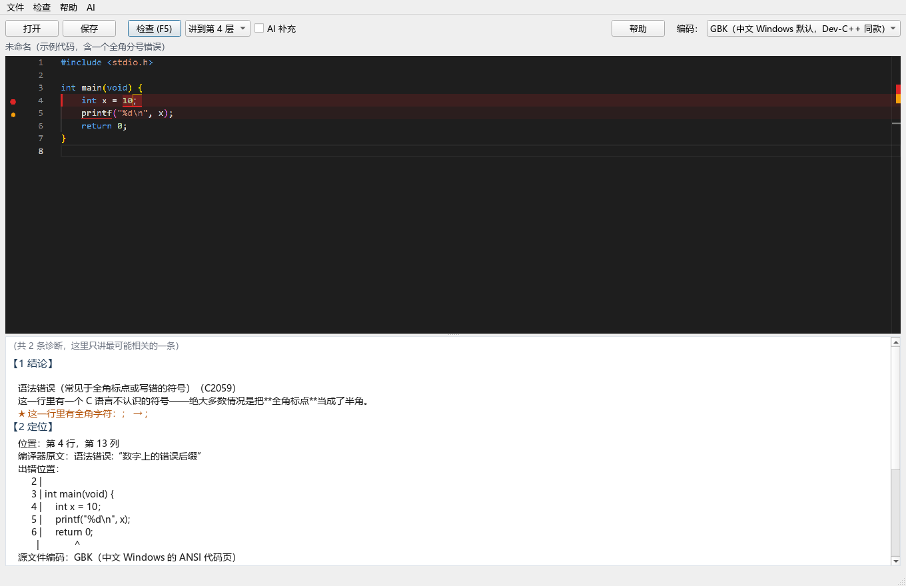
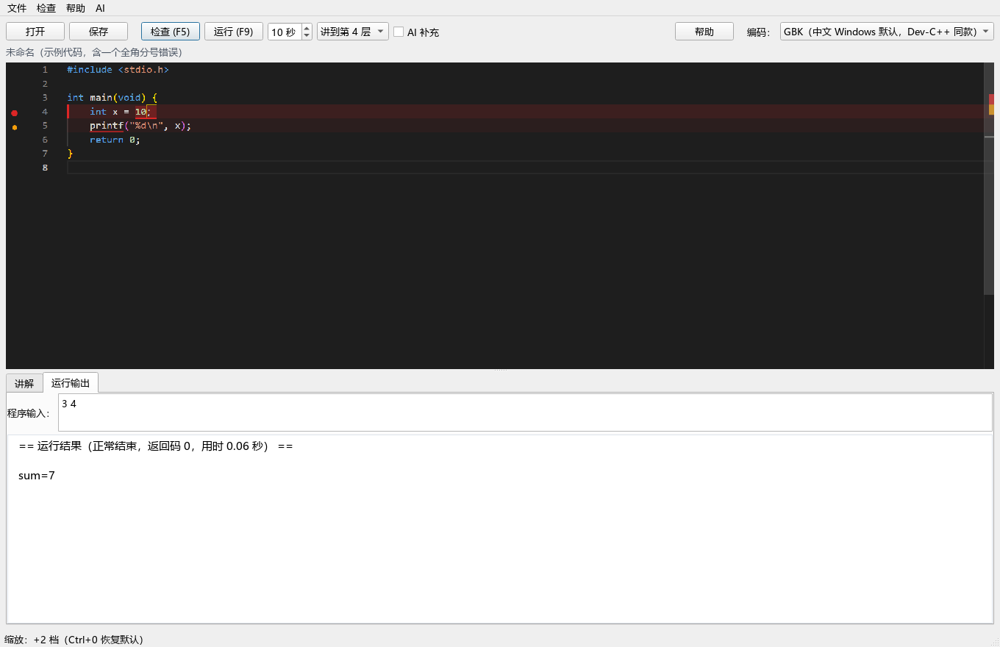
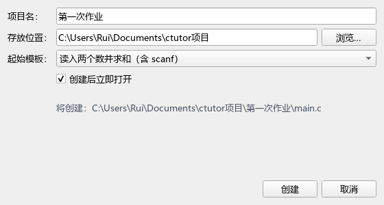
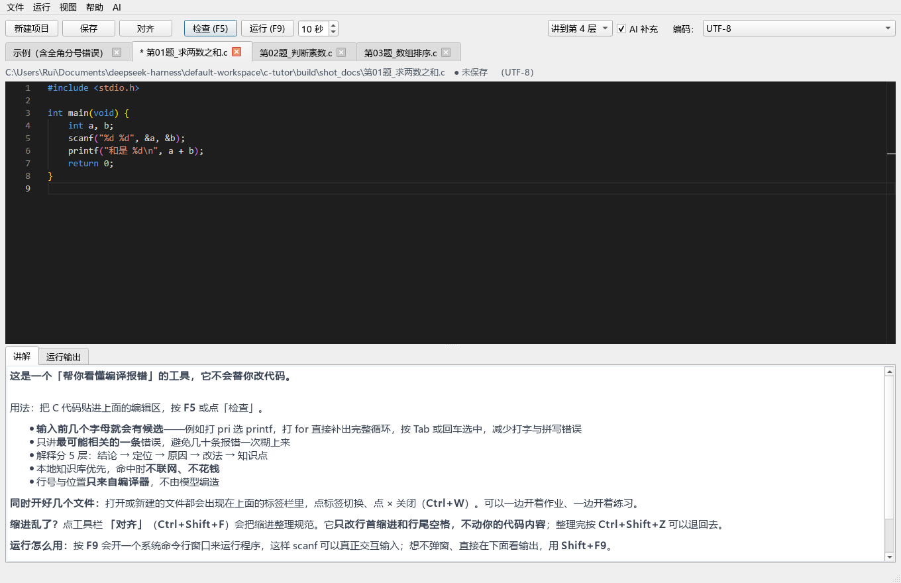
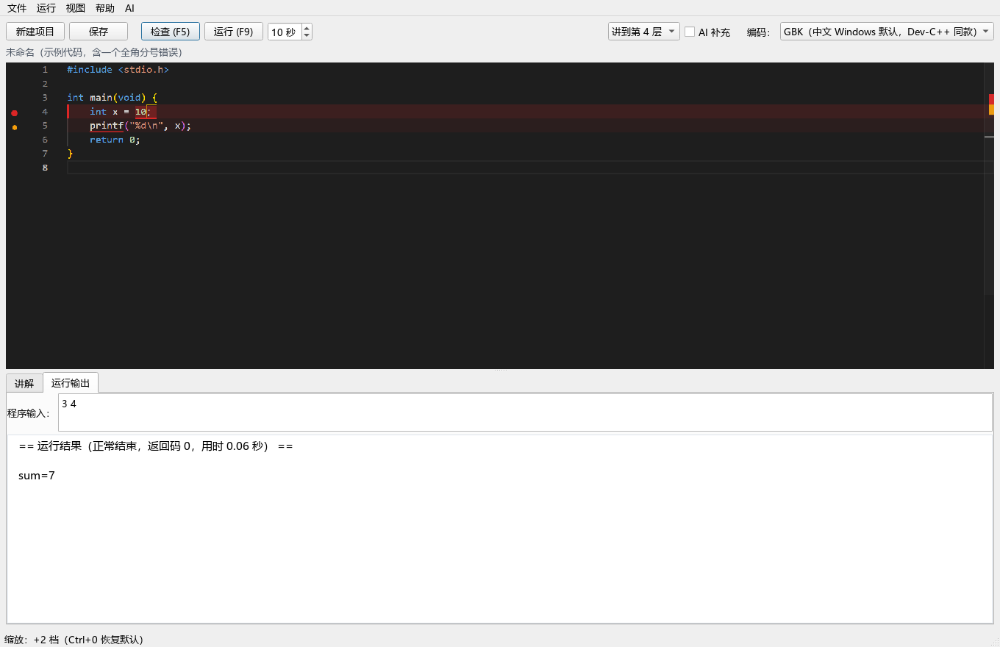

# ctutor — C 语言报错解释器

**定位：只解决「编译不过、看不懂」，不解决算法、调试。** ctutor **不会修改你的代码。**

面向中文初学者的 C 语言报错解释工具。Python + 命令行 + 本地知识库优先，AI 负责解决缓冲库之外的错误。

## 快速开始（无注册表）

**最简单：双击桌面上的「C语言报错助手」图标。**

备用入口：项目目录下的 启动面板.bat。

命令行方式（面板与命令行共用同一套引擎）：

**依赖情况**：命令行只用标准库；图形面板需要 PySide6 与 qtmonaco

配置密钥：见下方「如何接入 AI」。**不要把密钥写进代码或提交到仓库。**

| 项 | 说明 |
| --- | --- |
| 入口 | 打包时以 main.py 为入口：不带参数开图形面板，带子命令走命令行 |
| 程序根目录 | 冻结后 config.ROOT 取 exe 所在目录，而不是 PyInstaller 的临时解压目录——否则 log/、build/ 会写进临时目录，程序一关就没了 |
| 自带编译器 | 捆绑 w64devkit https://github.com/skeeto/w64devkit（便携 GCC），对方机器上没编译器也能用 |
| 体积 | w64devkit 解压后 708MB，脚本会砍掉对纯 C 教学无用的部分（32 位运行时、CMake、C++/Fortran 前端、gdb、文档），砍到约 360MB |
| 自动验证 | 打包完会运行打包出来的 exe 做离屏自检：能否启动、Monaco 是否加载、能否真编译一个样本、讲解是否命中。任一不通过就明确报错，不会让你把坏的包发出去 |

## 图形面板

出错位置标红

- **编辑器**：Monaco（VS Code 同款），C 语法高亮；Monaco 不可用时自动降级为普通文本编辑器，面板仍可用
- **代码补全**：输入前几个字母就弹出候选，Tab / 回车选中（见下）
- **出错位置标红**：出错的行直接在编辑器里标出来（见下）
- **一键检查**（F5）：编译 → 中文分层讲解，右侧同步高亮出错位置
- **一键运行**（F9）：先编译，通过后真的执行程序并把输出显示出来（见下）
- **同时开多个文件**：标签栏管理，可以一边开作业、一边开练习（见下）
- **关掉不丢进度**：下次打开自动回到上次那几个文件，连没保存的改动都在（见下）
- **AI 修改**（Ctrl+Shift+A）：让模型给出能编译的完整代码，三种对照方式任选（见下）
- **一键对齐缩进**（Ctrl+Shift+F）：缩进乱了点一下，只动空白、不动代码（见下）
- **Ctrl + 滚轮缩放**：编辑器与讲解区都能缩放，Ctrl+0 恢复默认，档位会记住
- **使用说明独立窗口**（F1）：点开 / 再点关闭，不再占用讲解栏；第一次使用自动弹出一次
- **深度可选**：讲到第 1~5 层
- **编码可选**：GBK / UTF-8 / UTF-8+BOM，状态栏显示当前编码
- **AI 补充**：勾选后仅在本地知识库未收录时调用 DeepSeek

。支持建立锚点；可建立锚点，一键跳转代码片段

### 一键运行

运行输出

#### 运行代码会遇到的情况

| 情况 | 处理 |
| --- | --- |
| 输出不是"实时"的 | 编译时强制包含一个小头文件，把 stdout/stderr 设成不缓冲：`printf` 一行就立刻出现在面板上，不再等程序退出（`printf("请输入 n: ")` 这种没换行的提示也会先显示） |
| 死循环（while(1)、忘写 i++） | 面板模式下超时后连子进程树一起杀（taskkill /F /T）：只算程序真正在跑的时间，超时秒数可调（默认 10 秒）；也可以点「停止」立刻终止 |
| 程序等输入（scanf） | 半交互：运行中在输入框回车逐行喂（不弹黑框），也可运行前一次填好；**等多久都不会超时**（等输入的时间不计入超时） |
| 输出刷屏 | 面板模式输出限长 200KB，超出提示已截断 |
| 程序崩溃 | Windows 只给一个巨大返回码，翻译成人话（见下） |
| 中文乱码 | 控制台按编译器选代码页；面板模式按 UTF-8 优先解码；编译时按源文件编码给 MSVC 加 `/utf-8`，UTF-8 源码里的中文串不会再被按 936 读成乱码 |
| 上次的窗口还开着 | 每次运行用独立工作目录（见下） |

### 新建文件

新建文件

Ctrl+N 或工具栏「新建文件」：填文件名、选存放位置、选起始内容，然后得到一个 .c 文件并直接在编辑器里打开。

- 默认存放位置是 文档\ctutor项目，改过之后会记住（文件 → 设置项目存放位置…）
- 内置 4 个模板：空白 / Hello World / 读入两个数求和（含 scanf）/ 带循环和数组
- 文件名会校验（非法字符、以点或空格结尾等），重名**不会静默覆盖**，先问一句
- 输入 作业1.c 不会变成 作业1.c.c——后缀由程序统一补

**扁平存放，不套文件夹。** 早期版本会建一个同名文件夹再往里面放 main.c：

### 关掉也不会丢（上次进度）

关程序时会把当前状态记下来，下次打开**直接接着写**：

- **还没保存的改动内容**——这一条最关键。只记文件名的话，写了一半忘了存， 下次打开文件里还是旧的，那段代码等于白写

恢复出来的未保存内容**标签上依然带 * 号**，不会让你误以为已经存盘了。

几条稳妥性设计：

| 情况 | 处理 |
| --- | --- |
| 文件没改过 | 只记路径，下次从磁盘重读（文件被别的程序改过也能拿到最新的） |
| 文件被删了 / 挪走了 | 跳过它，程序照常打开，不报错 |
| 会话文件坏了 / 格式不对 | 当作"没有上次进度"，退回示例代码，绝不因此打不开程序 |
| 从没保存过的新文档 | 内容只在会话里，照样能恢复 |

### 同时开多个文件

可以多开代码，方便对照

- 点标签切换，点 × 关闭（Ctrl+W），标签可以拖动排序
- **各标签互不干扰**：内容、光标、编码、上一轮的标红都各自保存
- 已经打开过的文件再打开会**跳过去**，不会开出两份来改乱
- 标签标题带 * 表示有未保存改动，路径栏也会写 ● 未保存

### 关程序一定要保存啊

初学者最容易丢东西的一步：写了一半直接点右上角 X。

所以**关标签**和**退出程序**时，只要那个文件有未保存改动，都会先弹一句「保存 / 不保存 / 取消」。选「取消」就什么都不做，回到编辑状态。

### AI 修改：让模型给一份能编译的代码

工具栏「AI 修改」会先问你**想怎么看改了什么**，三种方式：

| 方式 | 原文件 | 适合 |
| --- | --- | --- |
| 原位修改 | 直接改进编辑器，标签带 * | 想马上看到结果，改完点「对照」比一比 |
| 独立窗口 | 一个字都不动 | 想两个窗口并排看，边看边自己改 |
| 行内注释 | 一个字都不动 | 只想看提示，自己动手改 |

「对照」按钮（Ctrl+Shift+D）会把修改前后逐行对比：绿色是新增、红色是删掉的。

- **模型说没把握就不给代码**，只给建议

### 右键菜单（全中文）

- 编辑器里右键弹出的是全中文菜单：剪切 / 复制 / 粘贴 / 删除 / 全选 / 添加锚点… / 锚点列表… / 删除本行锚点 / 撤销 / 重做，右侧带 Ctrl+X 这类快捷键提示。

### 锚点（书签）

- 添加：编辑器里右键 → 添加锚点…，默认用当前行的代码起名，可以改成「主循环」这种好认的名字。
- 显示：锚点贴在编辑器最右端，是一条写着名字的蓝色标签；点一下光标直接跳到那一行并居中。
- 管理：工具栏「锚点」（或右键 → 锚点列表…）列出全部锚点，双击跳转；同一行再加一次＝改名，不会叠成两条。
- 跟着走：滚动、缩放、改窗口都跟着动；编辑代码后锚点跟着原来那一行移动；滚出视野自动隐藏。
- 零影响：不往 .c 里插字符、不加注释、不标「已修改」，只存在会话文件里，发给别人也看不到。

### 一键对齐（整理缩进）

工具栏「对齐」（Ctrl+Shift+F）：按大括号层级把每行缩进重新排一遍。

**它只动空白。** 这是硬约束，不是口号：

| 会改 | 不会改 |
| --- | --- |
| 行首缩进 | 任何非空白字符 |
| 行尾多余空格 | 行的顺序、行的数量 |
| 空行里残留的空格 | 有没有换行 |

### Ctrl + 滚轮 / Ctrl + 加减号缩放

| 操作 | 效果 |
| --- | --- |
| Ctrl + = 或 Ctrl + + | 放大 |
| Ctrl + - | 缩小 |
| Ctrl + 0 | 恢复默认字号 |
| Ctrl + 滚轮 | 在编辑器、讲解区、运行输出区都能缩放 |

### 出错位置标红

只在下方给个行号，还得自己数行——所以直接把错误画在代码上

| 对象 | 表现 |
| --- | --- |
| 正在讲的那一条 | 整行深红底 + 左侧红边 + 行号区红点 + 具体 token 红色下划线 |
| 其它错误 | 整行淡红底 + 行号区橙点（让他知道"别处还有问题"，但不抢注意力） |
| 警告 | 默认不标，否则页面花花绿绿反而看不清重点 |
| 滚动条 | 右侧 overview ruler 同步打点，滚动到别处也知道哪几行有问题 |

## 代码补全（减少打字与拼写错误）

输入前几个字母就会弹出候选，例如打 pri 选 printf、打 for 直接补出完整循环。

**词条是可编辑的数据文件**：data/completion.json（86 条，教师可自行增删）。构成：12 个代码片段 + 25 个关键字 + 44 个标准库函数 + 3 个常量 + 1 个类型 + 1 个结构体。

| 片段 | 内建的"正确范式" |
| --- | --- |
| scanf | 带 &（漏 & 是初学者最常见的运行时崩溃原因） |
| for | 两个分号 + 花括号（不会写成逗号，也不会漏花括号） |
| if / else | 完整的配对结构（避免 if 后误加分号导致 else 悬空） |
| main | 标准 int main(void) 写法 |
| swap | 借助第三个变量（不会写出互相覆盖的错误交换） |
| include | 下拉可选 stdio.h / stdlib.h / string.h / math.h |

## 如何接入 AI

AI 是**可选增强**，不配也能用——本地知识库命中时本来就不联网、不需要密钥。

### 三步启用

1. 拿到 DeepSeek API Key（platform.deepseek.com 创建，sk- 开头）
2. 用下面任一种方式配置：

| 方式 | 操作 | 适合 |
| --- | --- | --- |
| 面板菜单（推荐） | 打开面板 → 菜单 AI → 设置 DeepSeek 密钥… → 粘贴 → 确定（会自动测一次连接） | 所有人 |
| 命令行 | python cli.py set-key（输入时不回显） | 习惯终端 |
| 环境变量 | set DEEPSEEK_API_KEY=sk-xxxx | 临时试用、CI |

3. 面板里勾上 **「AI 补充」**（勾选状态会记住）

### 密钥存在哪里

写到 **%APPDATA%\ctutor\config.json**，而不是项目目录。这样：

- 把项目文件夹打包分享/开源时**不会把密钥带出去**；
- 项目移动位置后密钥仍然有效；
- 项目内的 config/ctutor.json 也被 .gitignore 忽略，双保险。

优先级：**环境变量 > 用户配置 > 项目配置**（环境变量最高，便于临时覆盖）。

### 什么时候会调用、花多少钱

只在**本地知识库没有收录**这个错误码时才调用一次。命中时零成本零延迟。

实测（当时用的模型是 deepseek-flash，现默认 deepseek-chat）：单次解释 tokens in=718 out=248，其中 **512 个 token 命中上下文缓存**，成本约 **0.0015 元**；缓存命中价 $0.003/M 与未命中 $0.15/M 相差 50 倍，所以系统提示被刻意做成字节稳定的前缀

### 安全与质量上的约束（都有测试）

- **位置只来自编译器**——模型返回的任何行号/文件名一律丢弃
- 模型输出必须通过 JSON schema 校验；失败重试一次，再失败**降级为只给定位**
- 输出完全不是 JSON 时**失败关闭**，不展示未经校验的自由文本
- **答案泄漏守卫**：剥离完整可复制的代码解法
- 所有界面/日志里只出现**打码**后的密钥

## 三步开发的内容

**第一步 本地报错解释器**：编译 → 解析 → 中文知识库匹配 → 本地讲解，完全不联网。

**第二步 分层讲解**：一条诊断讲成 5 层（结论／定位／原因／改法／知识点），--depth 1..5 渐进披露。默认 4 层——本工具的本职就是给出明确的修改意见。

**第三步 接入 DeepSeek**：只在本地知识库未命中时调用；稳定前缀吃上下文缓存；JSON 校验 +重试 + 降级；答案泄漏守卫；位置锚定；发送前脱敏。

## 知识库是怎么长起来的

第一版 27 + 25 条是按调研方案手工写的。之后分两轮扩充到 61 + 53 条， **每一轮的来源都不同，可信度也不同**：

| 轮次 | 来源 | 可靠性 |
| --- | --- | --- |
| 第一版 | 调研方案（c-error-helper 等开源规则）+ 人工撰写 | 中 |
| 第二轮 | tools/probe_snippets.py 对 MSVC 14.51 / GCC 16.2 的真实编译实测 | 高（码是编译器自己报的） |
| 第三轮 | 三个并行调研：英文社区高频清单、中文社区与中国高校材料、开源知识库审计 | 参考（需实测确认） |

### 中文特有问题单独处理

这些是英文项目结构上覆盖不到的，也是本项目存在的理由：

- **全角标点**（U+FF1B 等）：MSVC 说"数字上的错误后缀"、GCC 16 说 invalid suffix '；'
- **全角空格 / 不间断空格 / 零宽字符**：**最坑的一类**
- **编码错位**：C4819 / GCC 的 stray 系列

### 错误雪崩：一次报几十条不代表错了几十处

编译器经常一次喷几十条错误，但它们绝大多数是**第一条的连锁反应**。本工具只讲第一条，并且在错误数 ≥3 时明确提示：

一次报很多条通常**不是很多个错误**——第一条往往是根因，修好它之后后面那些多半会一起消失。先只改下面讲的那一处，再重新检查。

## 已知限制

- 知识库 61 + 53 条，
- 打包出的 exe 没有做代码签名，Windows SmartScreen 可能提示"未知发布者"， 点"更多信息 → 仍要运行"即可。

## 两个编译器后端的实测差异

GCC 与 MSVC 对同一个错误的报法完全不同，本项目两个后端都已用真实编译器验证过（GCC 16.2.0 / w64devkit、MSVC 14.51）。代表性的差异：

| 场景 | MSVC | GCC |
| --- | --- | --- |
| 漏分号 | C2146 缺少";" | expected ',' or ';' before 'printf'（无错误码） |
| 全角分号（GBK 源码） | C2059 语法错误:"数字上的错误后缀" | stray '\243' in program |
| 漏 #include | C4013（仅警告，程序照跑） | -Wimplicit-function-declaration（错误） |
| main 拼错 | LNK1561（文本，不进 SARIF） | undefined reference to 'main'（文本，无行号） |
| 变长数组 int a[n] | C2133/C2057 报错 | 合法，无诊断 |
| scanf 漏 & | C4477 + C4700（警告） | -Wformat + -Wuninitialized（警告） |
